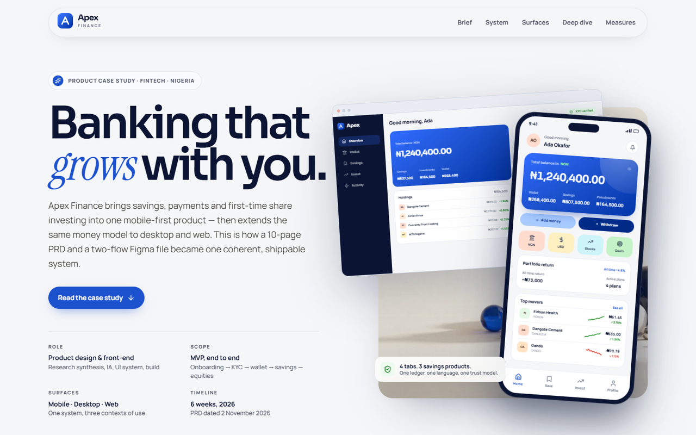
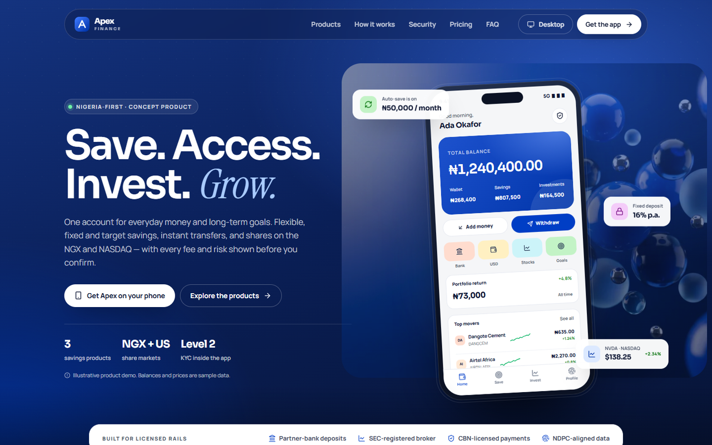
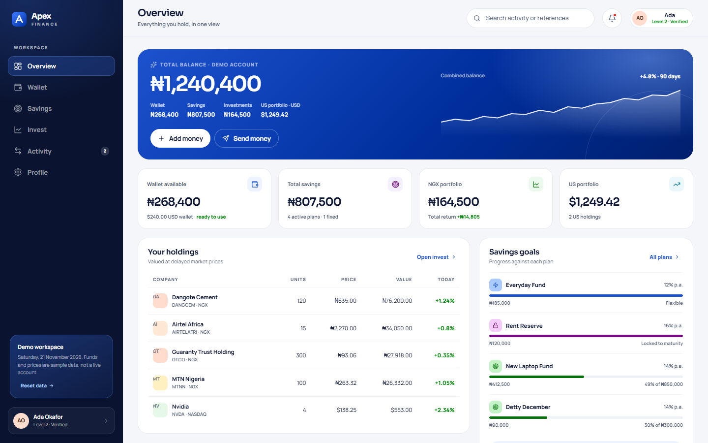
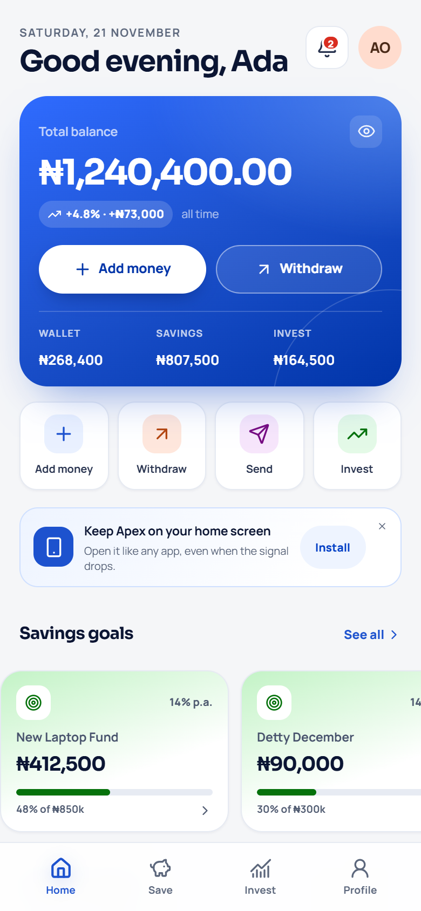

# Apex Finance

A four-surface product suite for a fictional Nigerian savings-and-investing app: a design case study, a marketing site, a desktop web app, and a mobile PWA. All four are live, built from this npm-workspaces monorepo, and share one design-token layer.

## Live links

| Surface | URL | What it is |
| --- | --- | --- |
| Case study | [apex-finance-case-study.vercel.app](https://apex-finance-case-study.vercel.app) | The design case study: problem, process, decisions and outcomes |
| Website | [apex-finance-website.vercel.app](https://apex-finance-website.vercel.app) | Marketing site for the product |
| Desktop app | [apex-finance-desktop.vercel.app](https://apex-finance-desktop.vercel.app) | Desktop web app demo |
| Mobile PWA | [apex-finance-mobile.vercel.app](https://apex-finance-mobile.vercel.app) | Installable mobile app demo |

The demo apps sign in with a real one-time code from the API; until an SMS gateway is configured the code is returned as `devCode` and shown on the OTP screen. No real money moves.

## Screenshots

| Case study | Marketing website |
| --- | --- |
|  |  |
| **Desktop app** | **Mobile PWA** |
|  |  |

All four run the shared demo account (Ada Okafor). Also: [desktop invest screen](docs/screenshots/desktop-invest.png).

## Repository layout

```
apps/case-study   design case study
apps/website      marketing site
apps/desktop      desktop web app
apps/mobile       mobile PWA
apps/api          API + double-entry ledger (Postgres)
packages/shared   shared design tokens, components, money helpers and API types
```

## Run locally

Requires Node 20+ and npm.

```bash
npm install
npm run dev:case      # case study
npm run dev:site      # marketing site
npm run dev:desktop   # desktop app
npm run dev:mobile    # mobile app
npm run dev:api       # API on :4000 (serves the ledger, falls back to demo state without a database)
```

The two apps proxy `/api` to `http://127.0.0.1:4000` in development and to the deployed API in production, and fall back to an identical local demo state when the API is unreachable.

## Ledger

Balances are derived from postings, never stored. Every write goes through `post_entry`, which rejects an entry whose postings do not net to zero in each currency, and postings are append-only.

```bash
npm run -w @apex/api db:init      # create the local cluster in apps/api/.pgdata (first run)
npm run -w @apex/api db:up        # start Postgres on :5433
npm run -w @apex/api db:migrate   # apply migrations/*.sql
npm run -w @apex/api db:seed      # post the demo account from packages/shared
npm run -w @apex/api test         # ledger invariants against the running database
```

The deployed API reads `DATABASE_URL` when it is set and returns the packaged seed otherwise; `GET /api/health` reports which one answered as `storage`.

Writes go through `POST /api/deposit`, `POST /api/trade` and `POST /api/plans/:id/fund`. Each returns the full `MobileStateResponse` after committing, takes an optional `reference` for idempotency, and answers failures with `{ error, message }` plus a 4xx/503 status. The desktop and mobile stores call these for the seeded demo account and keep the server's transaction; withdrawals, transfers, new plans and plan withdrawals are still local to each app.

## Accounts and sign-in

Each user is a phone number with its own ledger owner. Signing up provisions a zeroed account (wallet and external accounts in NGN and USD, plus a `new` profile) on first verification, and every read and write is scoped to the bearer token that verified it.

- `POST /api/auth/request-code` — `{ phone }` → `{ challengeId, expiresAt, devCode? }`. Codes are six digits, hashed at rest, valid for 10 minutes, max five attempts, max five per phone per 10 minutes.
- `POST /api/auth/verify-code` — `{ challengeId, code, name?, email? }` → `{ token, expiresAt, owner, state }`. Creates the user and ledger accounts the first time that phone verifies.
- `POST /api/auth/logout` with `Authorization: Bearer <token>` revokes the session.
- `GET /api/state` and the write endpoints accept the bearer token; without one they fall back to the shared demo account so the public demo still works.

Set `AUTH_SECRET` in the API environment to pepper the stored code hashes; without it a development default is used. `+234 803 555 0147` maps to the seeded demo owner; any other number gets its own account. Sessions live in `sessions` (30 days) and the token is kept in `localStorage` as `apex.session.v1`.

### SMS delivery

Set `SMS_PROVIDER` to `termii`, `twilio` or `africastalking` and the matching credentials; the code is then sent by SMS and `devCode` is omitted from the response (the apps hide the demo hint and the "Use demo code" shortcut accordingly). Without a provider the API keeps returning `devCode` so the demo can be used.

| Provider | Variables |
| --- | --- |
| Termii | `TERMII_API_KEY`, optional `TERMII_SENDER_ID` (default `N-Alert`) |
| Twilio | `TWILIO_ACCOUNT_SID`, `TWILIO_AUTH_TOKEN`, `TWILIO_FROM` |
| Africa's Talking | `AT_USERNAME`, `AT_API_KEY`, optional `AT_SENDER_ID` |

An SMS failure rolls the challenge back and answers `502 sms_failed`, so the attempt does not count against the per-phone limit.

## Rate limits

Limits are stored in Postgres (`rate_limits`), so they hold across serverless instances instead of per process.

| Endpoint | Limit |
| --- | --- |
| `POST /api/auth/request-code` | 10 per IP per 10 minutes (plus the per-phone limit above) |
| `POST /api/auth/verify-code` | 40 per IP per 10 minutes (plus five quick guesses per challenge) |
| `GET /api/state` | 300 per IP per minute |
| Deposits, trades and plan funding | 30 per account and 60 per IP per minute |

Exceeding a limit answers `429 too_many_requests`. Old rows are pruned opportunistically.

## Backups

- **Point-in-time restore:** the production database is Neon. Its history retention is set in the Neon console (free plan keeps about six hours; paid plans up to 30 days) and can restore a branch to any moment inside that window.
- **Daily logical backups:** `.github/workflows/db-backup.yml` runs `pg_dump` at 02:00 UTC (and on demand) and keeps a custom-format dump as a workflow artifact for 30 days. Add a repository secret named `DATABASE_URL` with the production connection string; without it the job fails instead of uploading an empty file.
- **Restore:** `pg_restore --clean --no-owner --no-privileges --dbname "$DATABASE_URL" apex-YYYY-MM-DD.dump`. Run migrations afterwards (`npm run -w @apex/api db:migrate`) in case the dump predates them.

## Build

```bash
npm run build           # all four surfaces
npm run build:case
npm run build:site
npm run build:desktop
npm run build:mobile
```

Each app builds to its own `dist/` directory and deploys to Vercel as a static site.

### Preview deployments

Every pull request builds a preview of all four surfaces. `.github/workflows/preview.yml` asks the Vercel API for a deployment of each project, waits for it to become ready, and keeps one comment on the PR updated with the four URLs. The comment is edited in place on later pushes, and an in-progress run is cancelled when a newer push arrives.

The workflow needs a repository secret named `VERCEL_TOKEN` holding a Vercel access token for the `dera19` team. Pull requests from forks never receive repository secrets, so their previews cannot be built and the job says so instead of failing silently.

<!-- preview smoke test -->
